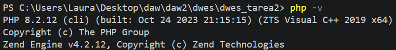
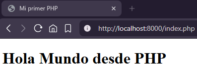
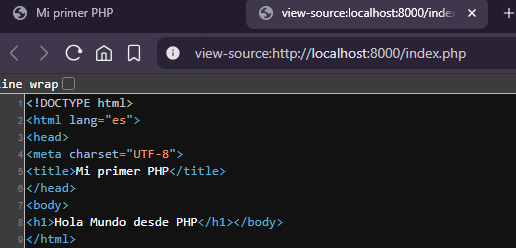
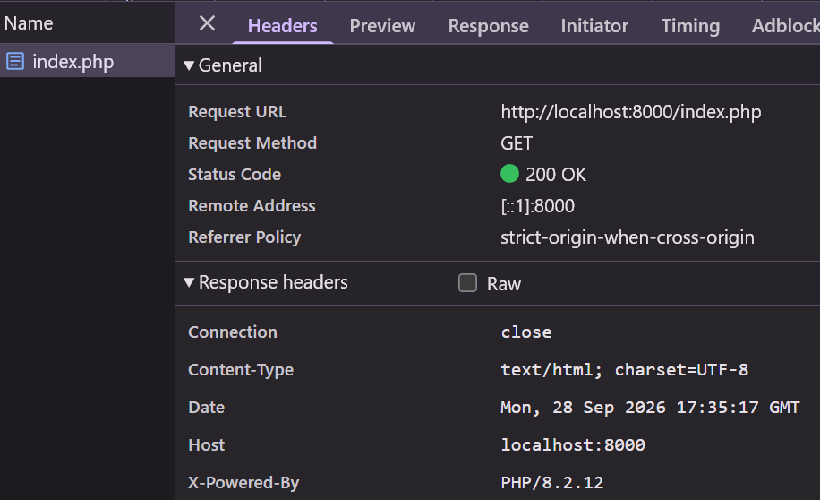

# TAREA 2 (RA1): Configuración del Entorno Local y Verificación del Motor PHP
Configuración de un entorno de desarrollo local con PHP y Visual Studio Code, ejecución mediante el servidor integrado de PHP y análisis del procesamiento en servidor y la comunicación HTTP.

## 🚀 Resultados Visuales
- **Comprobación de versión de PHP:**  
  

- **Ejecución en navegador (`http://localhost:8000/index.php`):**  
  

- **Código fuente en cliente (Ctrl + U):**  
  

- **Análisis de cabeceras en Herramientas de Desarrollador (F12):**  
  

## 🛠️ Tecnologías utilizadas
- PHP 8.x (CLI / Servidor integrado)
- Visual Studio Code (Extensión PHP Intelephense)
- Navegador Web (Herramientas de Desarrollador / F12)

## 📋 ¿Qué se hizo? (Funcionalidades)
- **Preparación del entorno:** Verificación de la versión de PHP (`php -v`) y configuración del entorno de desarrollo en VS Code.
- **Creación del proyecto:** Configuración de la estructura de trabajo e implementación del script inicial `index.php`.
- **Servidor local integrado:** Despliegue del servidor de desarrollo mediante el comando `php -S localhost:8000`.
- **Análisis de procesamiento en servidor:** Verificación del código fuente del cliente (Ctrl + U) comprobando que el código PHP se ejecuta en el servidor y solo se envía código HTML procesado.
- **Inspección de peticiones HTTP:** Análisis de la comunicación cliente-servidor examinando el método de petición, código de estado y cabeceras de respuesta (`Content-Type`).

## ⚙️ Cómo ejecutarlo localmente
1. Clona o descarga el repositorio y accede a la carpeta del proyecto (`dwes_tarea1_2`).
2. Abre la terminal en el directorio del proyecto y arranca el servidor local:
   ```bash
   php -S localhost:8000