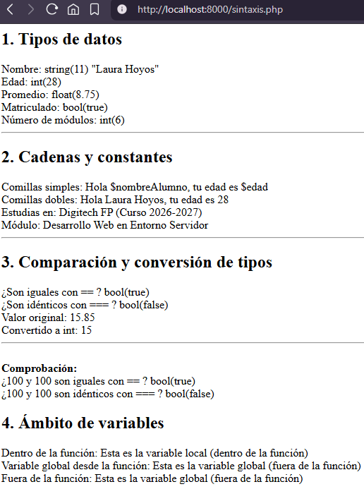
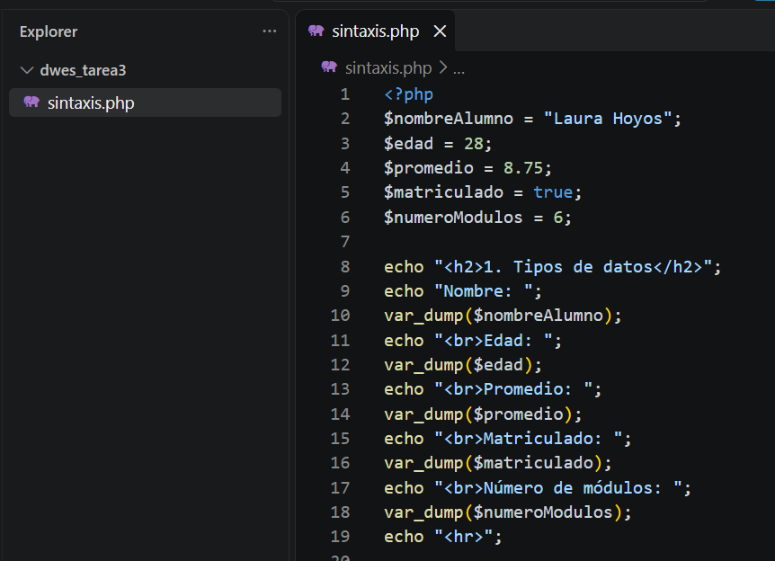
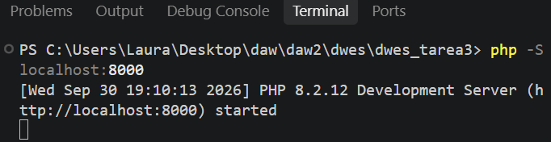

# TAREA 3 (RA2): Sintaxis, Tipos de Datos, Operadores y Ámbito de Variables en PHP
Estudio e implementación de la sintaxis fundamental de PHP: declaración y verificación de tipos de datos (`var_dump`), evaluación de cadenas y constantes, comparación e interpolación de tipos, y gestión del ámbito de variables (`global` / `local`).

## 🚀 Resultados Visuales
- **Ejecución completa en el navegador (`http://localhost:8000/sintaxis.php`):**
  

- **Código fuente en Visual Studio Code (`sintaxis.php`):**
  

- **Servidor local PHP activo en la terminal:**
  

## 🛠️ Tecnologías utilizadas
- PHP 8.x (CLI / Servidor integrado)
- Visual Studio Code (Extensión PHP Intelephense)
- Navegador Web (Herramientas de Desarrollador / F12)

## 📋 ¿Qué se hizo? (Funcionalidades)
- **Variables y tipos escalares:** Declaración de datos personales, incorporación de la variable `$numeroModulos` (entero) y verificación de tipo/valor mediante `var_dump()`.
- **Cadenas y constantes:** Definición de constantes (`INSTITUTO`, `CURSO` y `MODULO`) y análisis práctico del comportamiento de la interpolación de variables usando comillas simples (`' '`) frente a comillas dobles (`" "`).
- **Comparación y conversión de tipos:** Evaluación de igualdad débil (`==`) e identidad estricta (`===`) sobre variables de distinto tipo (`$valor1` y `$valor2`), junto con el casteado explícito de flotante a entero `(int)`.
- **Ámbito de variables (Scope):** Demostración del alcance de variables locales frente a globales utilizando la palabra clave `global` dentro de funciones.

## ⚙️ Cómo ejecutarlo localmente
1. Clona o descarga el repositorio y accede a la carpeta del proyecto (`dwes_tarea3`).
2. Abre la terminal integrada en el directorio del proyecto y arranca el servidor local:
   ```bash
   php -S localhost:8000