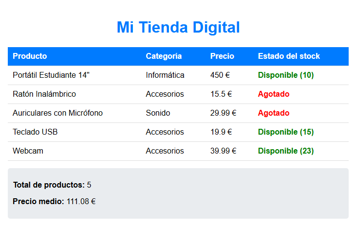
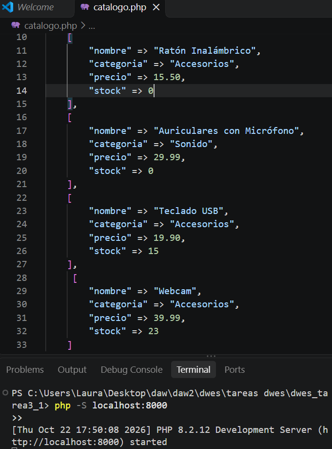

# TAREA 5 (RA3): Arrays Multidimensionales, Bucles y Condicionales en PHP
Estudio e implementación de la sintaxis fundamental de PHP: definición y recorrido de arrays multidimensionales (`foreach`), cálculo de estadísticas de datos (totales y medias), y estructuración de control condicional (`if` / `elseif` / `else`) para la renderización dinámica de productos y stock en HTML5.

## 🚀 Resultados Visuales
- **Ejecución completa en el navegador (`http://localhost:8000/catalogo.php`):**  
  

- **Código fuente en Visual Studio Code (`catalogo.php`):**  
  

## 🛠️ Tecnologías utilizadas
- PHP 8.x (CLI / Servidor integrado)
- HTML5 / CSS3 (Plantilla integrada)
- Visual Studio Code (Extensión PHP Intelephense)
- Navegador Web

## 📋 ¿Qué se hizo? (Funcionalidades)
- **Arrays multidimensionales:** Definición de una estructura de catálogo `$productos` con 5 artículos, almacenando `nombre`, `categoría`, `precio` y `stock`.
- **Procesamiento de datos e iteración:** Cálculo del total de artículos mediante `count()`, acumulado de precios y cálculo de la media utilizando un bucle `foreach`.
- **Renderizado dinámico en HTML:** Generación de una tabla dinámica iterando sobre los productos y formateando los datos numéricos con `number_format()`.
- **Evaluación condicional de stock:** Aplicación de estructuras `if / elseif / else` para clasificar y aplicar estilos CSS dinámicos según la disponibilidad (`Agotado`, `Últimas unidades` o `Disponible`).

## ⚙️ Cómo ejecutarlo localmente
1. Clona o descarga el repositorio y accede a la carpeta del proyecto (`dwes_tarea3_1`).
2. Abre la terminal integrada en el directorio del proyecto y arranca el servidor local:
   ```bash
   php -S localhost:8000