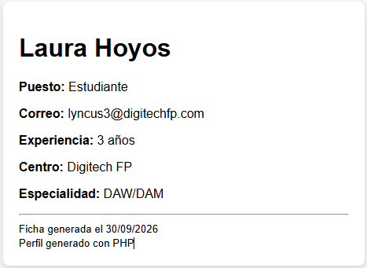
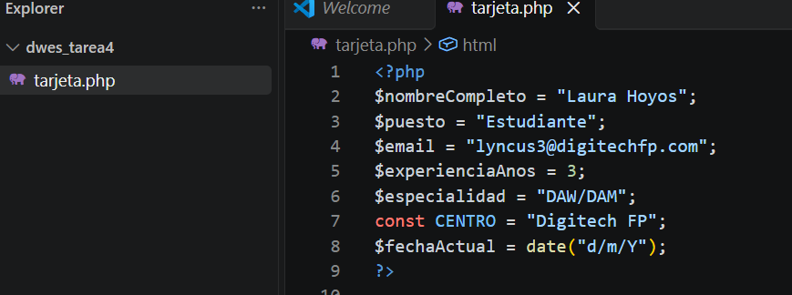
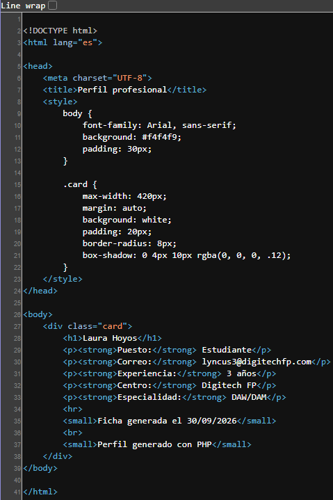

# TAREA 4 (RA2): Generación de una Plantilla HTML5 Dinámica con Código Embebido
Creación de una tarjeta de perfil profesional dinámica mediante la integración de código PHP embebido en un documento HTML5, utilizando las sintaxis de renderizado corto (`<?= ... ?>`) y la salida con `echo`.

## 🚀 Resultados Visuales
- **Resultado de la tarjeta en el navegador (`http://localhost:8000/tarjeta.php`):**  
  

- **Código fuente en Visual Studio Code (`tarjeta.php`):**  
  

- **Código fuente HTML procesado recibido por el cliente (Ctrl + U):**  
  

## 🛠️ Tecnologías utilizadas
- PHP 8.x (CLI / Servidor integrado)
- HTML5 (Estructuración semántica y plantillas dinámicas)
- Visual Studio Code (Extensión PHP Intelephense)
- Navegador Web (Herramientas de Desarrollador / F12)

## 📋 ¿Qué se hizo? (Funcionalidades)
- **Bloque de datos en PHP:** Declaración de variables personalizadas (nombre, puesto, correo, años de experiencia) y fecha de generación dinámica mediante la función `date()`.
- **Integración de código embebido:** Inserción directa de valores dentro de etiquetas HTML5 combinando la sintaxis corta `<?= $variable ?>` y sentencias `echo`.
- **Incorporación de nuevos datos:** Adición de la variable `$especialidad` y un mensaje de pie de tarjeta personalizado ("Perfil generado con PHP").
- **Verificación de procesamiento en servidor:** Inspección del código fuente final enviado al navegador (Ctrl + U) verificando que las etiquetas PHP y variables quedan totalmente abstraídas en el servidor.

## ⚙️ Cómo ejecutarlo localmente
1. Clona o descarga el repositorio y accede a la carpeta del proyecto (`dwes_tarea4`).
2. Abre la terminal en el directorio del proyecto y arranca el servidor integrado de PHP:
   ```bash
   php -S localhost:8000