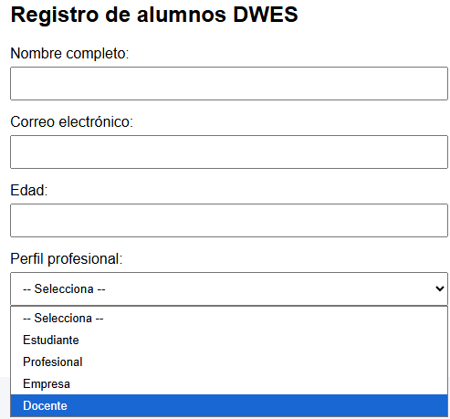
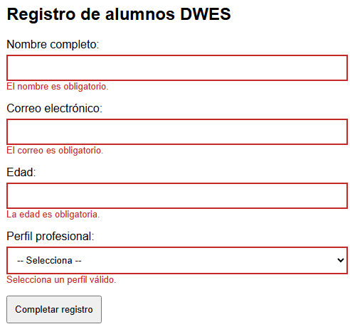
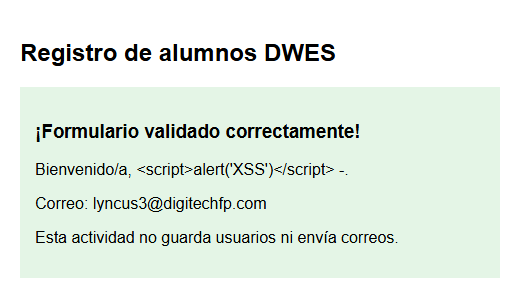
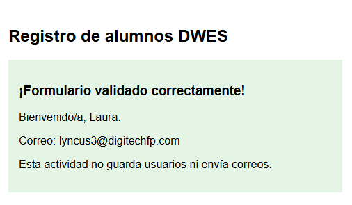

# TAREA 6 (RA3): Formulario de Registro Seguro en PHP
Desarrollo de un formulario de registro en PHP con envío de datos mediante `POST`, validación de campos en el servidor, conservación de los datos introducidos y protección frente a ataques XSS mediante `htmlspecialchars()`. Incluye personalización de los campos y perfiles disponibles.

## 🚀 Resultados Visuales
- **Formulario inicial de registro (`http://localhost:8000/registro.php`):**  
  

- **Errores de validación en el servidor:**  
  

- **Prueba XSS sin ejecución de JavaScript:**  
  

- **Registro completado correctamente:**  
  

## 🛠️ Tecnologías utilizadas
- PHP 8.x (CLI / Servidor integrado)
- HTML5
- Visual Studio Code
- Navegador Web

## 📋 ¿Qué se hizo? (Funcionalidades)

- **Envío de datos mediante POST:** Recepción de la información del formulario utilizando la variable superglobal `$_POST`.
- **Validación de campos:** Comprobación de nombre obligatorio (mínimo 3 caracteres), correo electrónico válido y edad entera entre 16 y 99 años.
- **Validación de perfiles:** Comprobación de que el perfil seleccionado pertenece a las opciones permitidas: Estudiante, Profesional, Empresa y Docente.
- **Conservación de datos:** Los valores introducidos se mantienen en el formulario cuando se producen errores de validación.
- **Protección frente a ataques XSS:** Utilización de `htmlspecialchars()` mediante la función `escaparHTML()` para evitar que el contenido introducido por el usuario se interprete como código HTML o JavaScript.
- **Mensajes de respuesta:** Visualización de errores junto a cada campo y mensaje de confirmación cuando todos los datos son válidos.

## ⚙️ Cómo ejecutarlo localmente

1. Clona o descarga el repositorio y accede a la carpeta del proyecto (`dwes_tarea6`).
2. Abre la terminal integrada en el directorio del proyecto y arranca el servidor local:

   ```bash
   php -S localhost:8000
   ```

3. Abre el navegador y accede a:

   ```text
   http://localhost:8000/registro.php
   ```

4. Prueba el formulario introduciendo datos incorrectos y correctos para comprobar las validaciones y la protección XSS.

## 📝 Observaciones

Esta actividad es una simulación educativa. No se almacenan usuarios en una base de datos ni se envían correos electrónicos.