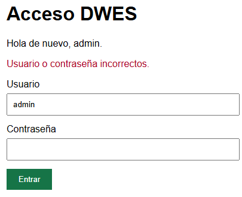
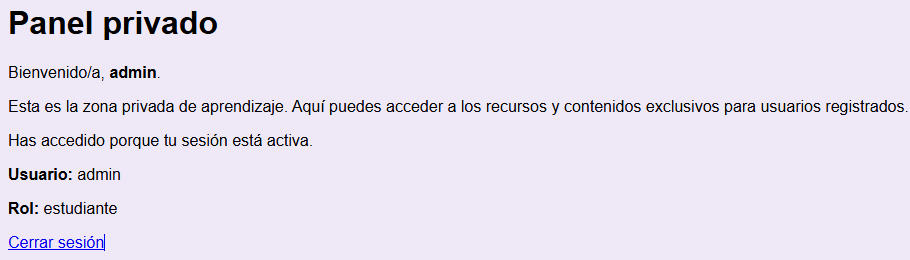
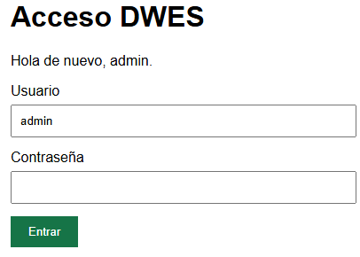

# TAREA 7 (RA4): Mi primer sistema de Login con Cookies y Sesiones

Desarrollo de un sistema básico de autenticación en PHP mediante sesiones y cookies. Implementación de un formulario de acceso, una zona privada protegida y un sistema de cierre de sesión, utilizando credenciales de demostración sin conexión a bases de datos.

## 🚀 Resultados Visuales

- **Formulario de acceso con mensaje de error:**  
  

- **Panel privado con sesión activa y datos del usuario:**  
  

- **Login con nombre de usuario recordado después de cerrar sesión:**  
  

## 🛠️ Tecnologías utilizadas
- PHP 8.x (CLI / Servidor integrado)
- HTML5
- CSS3
- Visual Studio Code
- Navegador Web

## 📋 ¿Qué se hizo? (Funcionalidades)

- **Sistema de autenticación:** Creación de un formulario de acceso que comprueba las credenciales introducidas mediante el método `POST`.
- **Gestión de sesiones:** Utilización de `session_start()` y `$_SESSION` para almacenar el usuario autenticado y su rol.
- **Control de acceso:** Protección del panel privado mediante comprobación de sesión y redirección al login si el usuario no está autenticado.
- **Cookies:** Creación de la cookie `nombre_recordado` con una duración de 30 días para conservar el nombre del usuario después de cerrar sesión.
- **Cierre de sesión:** Implementación de `logout.php` para vaciar los datos de sesión, eliminar la cookie identificadora y destruir la sesión, manteniendo la cookie de recuerdo.
- **Protección de datos:** Utilización de `htmlspecialchars()` para mostrar de forma segura la información del usuario.

## ⚙️ Cómo ejecutarlo localmente

1. Clona o descarga el repositorio y accede a la carpeta del proyecto (`tarea_7`).
2. Abre la terminal integrada en el directorio del proyecto y arranca el servidor local:

   ```bash
   php -S localhost:8000
   ```

3. Abre el navegador y accede a:

   ```text
   http://localhost:8000/login.php
   ```

4. Utiliza las siguientes credenciales de demostración:

   - **Usuario:** `admin`
   - **Contraseña:** `DWES2026!` 