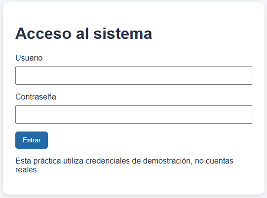
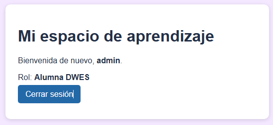
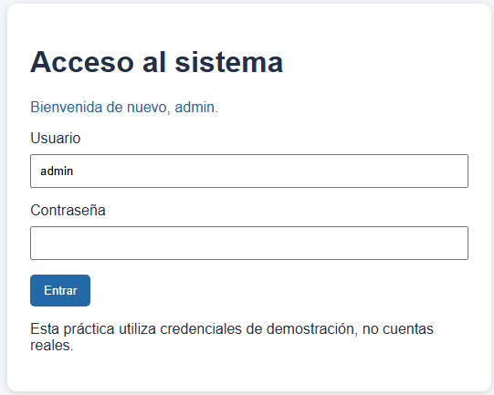

# Tarea 8 – RA4: Login, Panel Privado y Logout

Desarrollo de un sistema de autenticación en PHP utilizando sesiones y cookies para controlar el acceso a un panel privado.

## 🚀 Resultados Visuales
- **Acceso directo a panel.php redirigido al login:**  
  
- **Login con contraseña incorrecta y mensaje de error:**  
  
- **Panel tras iniciar sesión, mostrando usuario y rol:**  
  
  - **Login que recuerda admin, pero solicita de nuevo la contraseña:**  
  
  
## 🛠️ Tecnologías utilizadas

- PHP
- HTML5
- CSS3
- Sesiones PHP (`$_SESSION`)
- Cookies (`$_COOKIE` y `setcookie()`)
- VS Code

## 📋 ¿Qué se hizo? (Funcionalidades)

- **Login:** comprobación del usuario y contraseña mediante `password_verify()`.
- **Seguridad:** protección del panel privado mediante sesiones y regeneración del identificador de sesión.
- **Cookies:** almacenamiento del nombre de usuario durante 30 días para recordarlo en próximos accesos.
- **Panel privado:** muestra el usuario autenticado y su rol.
- **Logout:** cierre de sesión y eliminación de los datos de autenticación.
- **Personalización:** modificación de los mensajes, el título y los colores de la interfaz.

## ⚙️ Cómo ejecutarlo localmente

1. Abrir la carpeta `tarea_8` en VS Code.
2. Abrir una terminal dentro de esa carpeta.
3. Ejecutar el servidor PHP:

   ```bash
   php -S localhost:8000
   ```

4. Abrir en el navegador:

   `http://localhost:8000/login.php`

5. Utilizar las credenciales de demostración configuradas en `login.php`.

## 📝 Observaciones

Se han realizado las cinco pruebas indicadas en el enunciado para comprobar el funcionamiento del login, la protección del panel, el cierre de sesión y el recuerdo del usuario mediante cookies.

Las cookies permiten recordar el nombre de usuario, pero no mantienen la sesión iniciada.