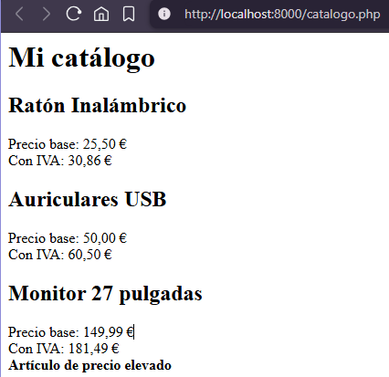

# TAREA 9 (RA5): Mi primer catálogo con POO

Desarrollo de un catálogo de artículos en PHP utilizando programación orientada a objetos (POO). Creación de una clase con propiedades privadas, constructor y métodos públicos, generación de varios objetos independientes y cálculo del precio final aplicando un 21 % de IVA.

## 🚀 Resultados Visuales

- **Catálogo con los tres artículos:**  
  

## 🛠️ Tecnologías utilizadas

- PHP 8.x (CLI / Servidor integrado)
- HTML5
- Programación orientada a objetos (POO)
- Visual Studio Code
- Navegador Web

## 📋 ¿Qué se hizo? (Funcionalidades)

- **Clase Articulo:** Creación de una clase para representar los artículos del catálogo.
- **Propiedades privadas:** Definición de las propiedades `nombre` y `precio` utilizando `private`.
- **Constructor:** Utilización de `__construct()` para inicializar los datos de cada artículo.
- **Métodos públicos:** Creación de métodos `getNombre()` y `getPrecio()` para consultar las propiedades.
- **Cálculo del IVA:** Implementación de `precioConIva()` para calcular el precio final aplicando un 21 % de IVA.
- **Comprobación de precios:** Creación del método `esCaro()` para detectar artículos cuyo precio supera los 50 €.
- **Creación de objetos:** Generación de tres artículos independientes mediante `new Articulo()`, cada uno con su propio nombre y precio.
- **Visualización del catálogo:** Implementación de la función `mostrarArticulo()` para mostrar los datos de cada artículo sin repetir código.
- **Protección de datos:** Utilización de `htmlspecialchars()` para mostrar los nombres de forma segura.
- **Formato de precios:** Uso de `number_format()` para mostrar los importes con dos decimales y formato español.

## ⚙️ Cómo ejecutarlo localmente

1. Clona o descarga el repositorio y accede a la carpeta del proyecto.
2. Abre la terminal integrada en el directorio del proyecto y arranca el servidor local:

   ```bash
   php -S localhost:8000
   ```

3. Abre el navegador y accede a:

   ```text
   http://localhost:8000/catalogo.php
   ```

4. Comprueba que aparecen los tres artículos, sus precios con IVA y que el aviso de precio elevado solo aparece para los artículos cuyo precio supera los 50 €.
